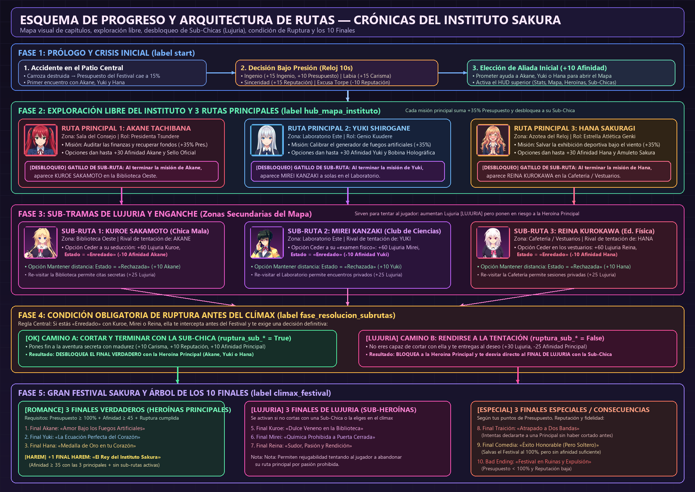

# 🌸 Crónicas del Instituto Sakura: ¡Líos en el Festival! 🏮

> **Novela Visual Interactiva de Comedia Romántica, Enredos Estudiantiles y Tentaciones al estilo Anime (*To Love-Ru* / *Bishoujo*).**



---

## 📖 ¿De qué trata la Novela Visual?

**«Crónicas del Instituto Sakura: ¡Líos en el Festival!»** es una novela visual interactiva ambientada en la víspera del gran **Festival Cultural de Otoño** del Instituto Privado Sakura.

Te pones en la piel de **Leo** (nombre personalizable), un estudiante con fama de meterse siempre en problemas que, al intentar llevar unas cajas por un atajo hacia la Sala del Consejo Estudiantil, provoca un accidente en cadena que pone en jaque los preparativos de las **tres chicas más populares del instituto**:

1. Los permisos y actas oficiales del **Consejo Estudiantil** desaparecen antes de la inspección del Subdirector.
2. El **Proyector Holográfico** del Club de Ciencias sufre una desalineación crítica.
3. La estrella del **Club de Atletismo** sufre un esguince en secreto justo antes de su exhibición frente al ojeador deportivo.

Para salvar el Festival antes del anochecer y conquistar el corazón de las heroínas principales, deberás recorrer libremente el campus del instituto. Sin embargo, cada solución te obligará a negociar con **tres sub-personajes sumamente seductoras y peligrosas** que intentarán arrastrarte a sus propios juegos de lujuria y tentación.

---

## 💖 Personajes y Estructura de Rutas

### 🌟 Las 3 Heroínas Principales (Historia Central)
Llevan el peso emocional y romántico principal de la historia. Alcanzar **`50%+ ♥`** con ellas (y mantenerte libre de ataduras secundarias) desbloquea sus **Finales Verdaderos** o el **Final Secreto Harem**:

| Heroína | Arquetipo | Rol en el Instituto | Conflicto Principal |
| :--- | :--- | :--- | :--- |
| ❤️ **Akane Tachibana** | *Tsundere* orgullosa pero tierna | Presidenta del Consejo Estudiantil | Superar la inspección del Subdirector y recuperar las Actas Secretas robadas. |
| 💙 **Yuki Shirogane** | *Kuudere* brillante y analítica | Genio del Club de Ciencias | Estabilizar el Proyector Holográfico e instalar la Bobina Experimental superconductora. |
| 🌸 **Hana Sakuragi** | *Genki* alegre y energética | Estrella del Club de Atletismo | Cuidar su lesión de tobillo y conseguir el Pase Oficial para actuar en pareja sin ser descalificada. |

### 😈 Las 3 Sub-Personajes de Tentación (*Modo Darkness*)
Cada una está directamente conectada al problema de una heroína principal. Te ofrecen atajos inmediatos para conseguir los objetos clave de la trama a cambio de caer en sus redes de seducción:

| Sub-Personaje | Ubicación | Conectada a | Rol y Tentación |
| :--- | :--- | :--- | :--- |
| 🔥 **Kuroe Sakamoto** | 📚 Biblioteca (Ala Oeste) | **Akane Tachibana** | La chica mala y rebelde que odia estudiar. Retiene las **Actas Secretas del Consejo** y exige un pacto prohibido entre las estanterías. |
| 🔥 **Mirei Kanzaki** | 🧪 Almacén Químico (Ala Este) | **Yuki Shirogane** | La voluptuosa sempai del Club de Ciencias. Guarda bajo llave la **Bobina Experimental** a cambio de «experimentos corporales» en privado. |
| 🔥 **Reina Kurokawa** | 🍱 Vestuarios del Jardín Sur | **Hana Sakuragi** | La ardiente y dominante capitana de Educación Física. Solo firmará el **Pase Oficial de Exhibición** tras una cita a solas en los vestuarios. |

> [!IMPORTANT]
> **Regla de Oro de las Sub-Rutas**: Si cedes a la tentación de **Kuroe**, **Mirei** o **Reina** (quedando en estado **`Enredado`**), **deberás regresar a sus zonas o enfrentarlas antes del Festival para terminar la aventura con ellas** si deseas alcanzar los Finales Principales con Akane, Yuki o Hana. Si decides no cortar con ellas, serás arrastrado a sus **Finales Prohibidos de Tentación**.

---

## 🎮 Mecánicas de Juego e Interfaz

* **🚶‍♂️ Sistema de Exploración Escolar en Primera Persona (Point-and-Click)**:
  * **Caminata Inmersiva por el Campus**: Explora el instituto en primera persona recorriendo escenarios visuales panorámicos 1080p en alta definición: Patio Central (`bg_courtyard`), Pasillo Principal 1F (`bg_hallway_1f`), Rellano Central de Escaleras con Ventanal (`bg_stairs`), Pasillo Superior 2F (`bg_hallway_2f`), Pabellón Deportivo y Taquillas (`bg_lockers_gym`) y el Almacén Secreto de Química (`bg_chem_lab`).
  * **Hotspots Interactivos con Animación ATL**: Haz clic en puertas de aulas, flechas de dirección de pasillos y accesos especiales con sutil animación de palpitación (*hotspot pulse*).
  * **Transiciones Cinemáticas Direccionales y Efectos de Sonido (SFX)**:
    * Avance de pasillos con `PushMove(0.35, "pushup")` y retroceso con `PushMove(0.35, "pushdown")`.
    * Subida y bajada de escaleras con `CropMove(0.38, "slideup" / "slidedown")`.
    * Desplazamiento lateral de alas con `PushMove(0.34, "pushright" / "pushleft")`.
    * Apertura de puertas corredizas de madera con fundido dramático `trans_door_open` y sonido sincronizado `sfx_door_slide.wav`.
    * Sonidos de pasos de calzado escolar interior `sfx_footsteps.wav`.
  * **Puntos de Inspección Interactiva (Lore, Secretos y Bonificaciones)**:
    * Inspecciona las taquillas de zapatos (getabako), el ventanal de cerezos, la cartelera oficial del Consejo, la vitrina de trofeos deportivos o los matraces de Mirei para descubrir notas secretas y obtener +5% en estadísticas.
  * **🗺️ Plano Isométrico Global Alternativo (Tecla `M` o Botón Superior)**:
    * En cualquier momento puedes abrir el plano general en perspectiva isométrica (`bg_school_map`) con resumen de etapas, conexiones y accesos directos.
* **🔒 Modales de Área Bloqueada con Regla de 3 Intentos (`1/3`, `2/3`, `3/3`)**:
  * Al intentar entrar en una zona bloqueada, un modal estilo *Trouble Alert!* te avisa que aún no puedes pasar (`Intento 1 de 3` y `Intento 2 de 3`).
  * **Al 3.er intento (`3/3`)**, se activa el **Escáner de Progreso y Puntos**, revelando exactamente **cuántos puntos de personaje te faltan (`% ♥` o `% 🔥`)** y qué eventos debes cumplir.
* **📈 Sistema de Puntuación Coherente (`0%` a `100%`)**:
  * Todas las estadísticas (`★ Reputación`, `⚡ Ingenio`, `✨ Carisma`, `🏮 Festival`), afinidades (`♥`) y niveles de lujuria (`🔥`) comienzan en **`0%`** y aumentan con cada decisión, regalo o actividad extra.
* **🏆 Panel de Progreso Total de la Partida (`0%` a `100%`)**:
  * Accesible en cualquier momento desde el botón dorado **`🏆 Progreso: X%`** del HUD superior.
  * Desglosa los **21 hitos que conforman el `100%` del juego completo** (Historia Principal `35%`, Sub-Rutas Darkness `25%`, Vínculos y Regalos Secretos `25%`, Exploración y Clímax `15%`), indicando qué tienes completado y cómo conseguir cada objetivo pendiente.
* **⏱️ Decisiones Bajo Presión (*Trouble Rush QTE*)**:
  * Eventos críticos con cuenta regresiva en tiempo real que ponen a prueba tus reflejos.
* **💖 Interfaz Visual Inspirada en *To Love-Ru***:
  * HUD permanente, tarjetas de heroínas, barras de progreso caramelizadas y ventanas modales con marcos *9-slice* ornamentados en tonos fucsia *Lala*, dorado *Golden Darkness*, violeta *Deviluke* y cian brillante.

---

## 🛠️ Tecnologías Utilizadas

1. **[Ren'Py Visual Novel Engine 8.5.3](https://www.renpy.org/)**:
   * Motor principal del juego ejecutándose sobre **Python 3** y **Pygame_SDL2**.
   * **Ren'Py Screen Language**: Construcción de interfaces reactivas (`stats_hud`, `girls_status_modal`, `sub_girls_modal`, `consequences_log_modal`, `game_progress_modal`, `school_hub_selector`, `locked_zone_modal` y `decision_bajo_presion`).
   * **ATL (*Animation and Transformation Language*)**: Animaciones fluidas de sprites, zoom dramático (`closeup_romance`), rebotes de alegría (`happy_bounce`, `excited_jump`), temblores de cámara (`camera_shake`) y pulsos luminosos (`pulse_glow`).
2. **Python 3 (`init python` & Herramientas de Pipeline)**:
   * Lógica de negocio en [`game/mechanics.rpy`](game/mechanics.rpy): máquina de estados de las 7 etapas, validación de requisitos mixtos (trama + puntos de personaje), diagnóstico dinámico al 3.er intento y cálculo porcentual del `100%` de la partida.
   * **Pillow (PIL)**: Procesamiento de sprites en alta resolución con canal alfa limpio (`tachi-e`) y generación procedural de todos los marcos ornamentados, botones e iconos de interfaz en [`game/images/ui/`](game/images/ui/).
3. **RenPyWeb 8.5.3 (HTML5 + WebAssembly + PWA)**:
   * Compilación completa a **WebAssembly (`renpy.wasm`)** y empaquetado de recursos en [`web-build/`](web-build) para jugar directamente desde el navegador sin instalación, con soporte de **Progressive Web App (`manifest.json` y `service-worker.js`)**.

---

## 🚀 Cómo Ejecutar el Juego

### 💻 1. Versión de Escritorio (Desde el código fuente con Ren'Py)
1. Abre **Ren'Py SDK 8.5.3** (o superior).
2. Selecciona el directorio del proyecto y haz clic en **Launch Project** (o ejecuta por consola):
   ```powershell
   & "D:\renpy\renpy-8.5.3-sdk\renpy.exe" "."
   ```

### 🌐 2. Versión Web (HTML5 / WebAssembly en Navegador)
La carpeta [`web-build/`](web-build) ya incluye la versión Web compilada y lista para producción:
* **En local (Windows)**: Haz doble clic en [`iniciar_servidor_web.bat`](iniciar_servidor_web.bat) o ejecuta:
  ```powershell
  python -m http.server 8042 --bind 127.0.0.1 --directory web-build
  ```
  Luego abre en tu navegador: **`http://127.0.0.1:8042/index.html`**
* **En producción (GitHub Pages / Netlify / Vercel / Itch.io)**:
  Sirve directamente el directorio [`web-build/`](web-build) como raíz estática de tu sitio web.

---

## 📂 Estructura del Proyecto

```text
├── game/
│   ├── script.rpy            # Guion completo, zonas del instituto, rutas y 7 finales
│   ├── mechanics.rpy         # Motor de puntuación (0-100%), mapa, bloqueos y progreso total
│   ├── custom_screens.rpy    # HUD estilo To Love-Ru, modales, mapa interactivo y QTE
│   ├── transforms.rpy        # Animaciones ATL de personajes y cámara
│   ├── options.rpy           # Configuración general del proyecto
│   ├── screens.rpy           # Pantallas base de Ren'Py
│   └── images/
│       ├── ui/               # Marcos 9-slice, botones, barras e iconos estilo To Love-Ru
│       └── *.png             # Fondos 16:9, sprites de las 6 chicas y miniaturas
├── web-build/                # Versión Web HTML5 / WebAssembly lista para desplegar
├── esquema_progreso_juego.png # Infografía visual de todas las etapas y rutas
├── progressive_download.txt  # Reglas de empaquetado de recursos para RenPyWeb
└── iniciar_servidor_web.bat  # Script para probar la versión Web localmente en 1 clic
```
